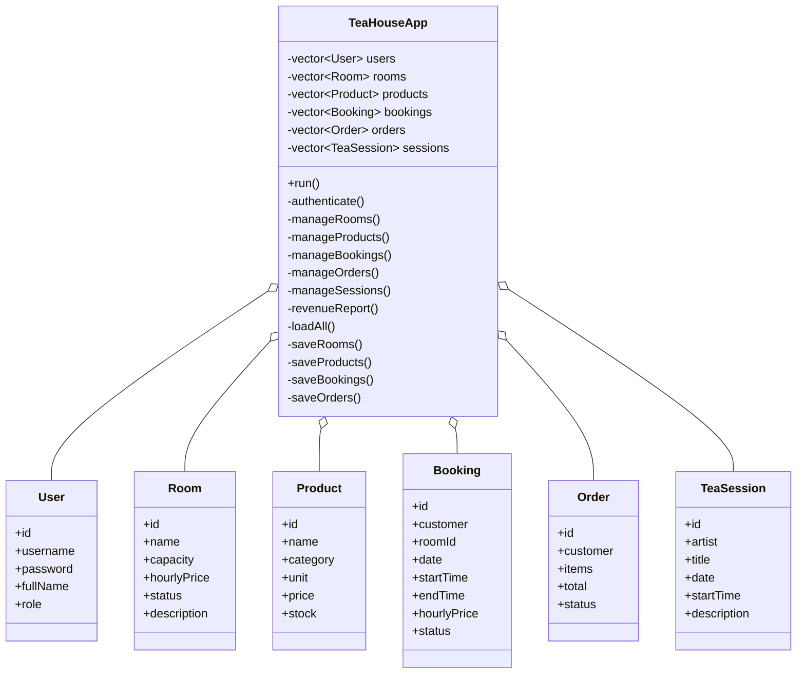

# BÁO CÁO PHÂN TÍCH VÀ THIẾT KẾ
## Phần mềm quản lý kinh doanh phòng trà – Tea House Management System

### 1. Mục tiêu
Xây dựng phần mềm dạng dòng lệnh (CUI) bằng C++ để hỗ trợ hoạt động kinh doanh phòng trà: quản lý phòng cho thuê, danh mục trà, trà cụ, đặt phòng, đơn hàng, hóa đơn, lịch thưởng trà và doanh thu. Dữ liệu được lưu bằng các tệp văn bản để có thể sử dụng lại sau khi đóng chương trình.

### 2. Phạm vi nghiệp vụ theo đề bài
- Cho thuê phòng uống trà theo giờ. Dữ liệu mẫu có mức giá từ 500.000 đến 2.000.000 VND/giờ/phòng.
- Phục vụ trà theo ấm; một ấm dùng khoảng 8–10g trà. Giá bán mẫu theo ấm nằm trong khoảng 100.000–500.000 VND.
- Bán trà đóng gói theo 50g, 100g, 200g, bánh trà 357g và 1kg.
- Danh mục trà mẫu: Ô Long, Thiết Quan Âm, Bạch trà ướp trầm, Đông Phương Mỹ Nhân.
- Danh mục trà cụ mẫu: ấm tử sa, ấm sứ, bộ khải, tống và bộ chén.
- Phân quyền cho năm nhóm người dùng: Owner, Staff, Artist, Customer và Guest.

Lưu ý: Giá bán theo khối lượng trong tệp dữ liệu là giá minh họa để kiểm thử, không phải báo giá được xác nhận từ một cửa hàng cụ thể.

### 3. Đối tượng sử dụng và chức năng
| Đối tượng | Chức năng hiện có |
|---|---|
| Owner | Quản lý tài khoản; quản lý phòng; quản lý trà và trà cụ; quản lý đặt phòng; tạo đơn; quản lý lịch thưởng trà; xem báo cáo doanh thu |
| Staff | Xem phòng; tạo/xem/hủy/hoàn thành đặt phòng; tạo đơn; xem hóa đơn; xem lịch thưởng trà |
| Artist | Xem lịch của mình; tạo lịch thưởng trà; xóa lịch do mình tạo |
| Customer | Xem phòng; đặt và hủy đặt phòng của tài khoản; xem trà; mua trà/trà cụ; xem đơn và hóa đơn của mình; xem lịch thưởng trà |
| Guest | Chỉ xem phòng, trà, trà cụ và lịch thưởng trà; không thực hiện giao dịch |

### 4. Quy tắc nghiệp vụ
1. Mỗi phòng có mã định danh duy nhất, sức chứa, giá thuê theo giờ và trạng thái Available/Maintenance.
2. Không cho phép đặt phòng đang bảo trì.
3. Không cho phép hai lịch đặt đã xác nhận của cùng một phòng bị trùng thời gian trong cùng ngày.
4. Ngày nhập theo `YYYY-MM-DD`; giờ theo định dạng 24 giờ `HH:MM`.
5. Thời lượng đặt phòng được làm tròn lên theo giờ để tính tiền dự kiến. Ví dụ 1 giờ 30 phút được tính 2 giờ.
6. Khi xác nhận đơn hàng, chương trình kiểm tra tồn kho, trừ số lượng và lưu đơn ở trạng thái Paid.
7. Doanh thu phòng chỉ cộng các booking Completed; doanh thu bán hàng chỉ cộng các order Paid.
8. Customer chỉ xem/hủy booking và xem hóa đơn gắn với username của mình.

### 5. Thiết kế hướng đối tượng
Chương trình định nghĩa các cấu trúc dữ liệu `User`, `Room`, `Product`, `Booking`, `Order`, `TeaSession` và lớp `TeaHouseApp`.

`TeaHouseApp` đóng gói các danh sách dữ liệu trong vùng `private`; các hàm xử lý đăng nhập, menu, quản lý danh mục, đặt phòng, đơn hàng và lưu tệp cũng được tổ chức trong lớp. Hàm `main()` chỉ khởi tạo đối tượng `TeaHouseApp` và gọi `run()`.



### 6. Lưu trữ dữ liệu
| Tệp | Nội dung |
|---|---|
| `users.txt` | Tài khoản và vai trò |
| `rooms.txt` | Phòng, sức chứa, giá thuê, trạng thái |
| `products.txt` | Trà/trà cụ, đơn vị bán, giá và tồn kho |
| `bookings.txt` | Lịch đặt phòng và trạng thái |
| `orders.txt` | Đơn hàng, chi tiết mặt hàng, tổng tiền và trạng thái |
| `sessions.txt` | Lịch thưởng trà và nghệ nhân phụ trách |

Các trường trong tệp được phân tách bằng ký tự `|`. Không nhập ký tự `|` trong nội dung tên/mô tả. Khi tạo đơn mới, chương trình lưu cả đơn giá tại thời điểm bán để hạn chế việc thay đổi giá danh mục làm sai chi tiết hóa đơn cũ.

### 7. Cấu trúc chương trình
- `main.cpp`: điểm bắt đầu chương trình.
- `TeaHouse.h`: khai báo cấu trúc dữ liệu và lớp `TeaHouseApp`.
- `TeaHouse.cpp`: cài đặt nghiệp vụ và thao tác với tệp.
- Các tệp `.txt`: dữ liệu khởi tạo và dữ liệu phát sinh.

### 8. Biên dịch và chạy
Mở Terminal tại thư mục chứa `main.cpp`, `TeaHouse.h`, `TeaHouse.cpp`:

```powershell
g++ main.cpp TeaHouse.cpp -o TeaHouse -std=c++17
.\TeaHouse.exe
```

### 9. Tài khoản mẫu
| Vai trò | Username | Password |
|---|---|---|
| Owner | owner | 123456 |
| Staff | staff01 | 123456 |
| Artist | artist01 | 123456 |
| Customer | customer01 | 123456 |

### 10. Giới hạn và hướng phát triển
- Mật khẩu hiện lưu dạng văn bản thuần để đơn giản hóa bài tập; không dùng thiết kế này cho hệ thống thật.
- Chưa tích hợp thanh toán điện tử, gửi email/SMS hoặc in hóa đơn PDF.
- Chưa có giao diện đồ họa; đây là ứng dụng CUI theo yêu cầu.
- Chưa có chức năng khách hàng đăng ký tài khoản từ màn hình; Owner tạo tài khoản.
- Dữ liệu dùng tệp văn bản, chưa có cơ chế nhiều người dùng thao tác đồng thời.
- Có thể phát triển tiếp: kiểm tra ngày đặt không ở quá khứ, chính sách hủy/đặt cọc, báo cáo theo khoảng ngày, xuất hóa đơn, đăng ký tham gia buổi thưởng trà và phân quyền chi tiết hơn.

---

## Gợi ý trình bày khi bảo vệ
1. Nêu bài toán kinh doanh và năm nhóm người dùng.
2. Giải thích vì sao chọn CUI, C++ và lưu dữ liệu bằng file.
3. Trình bày các cấu trúc dữ liệu và lớp `TeaHouseApp`.
4. Demo đăng nhập theo từng vai trò.
5. Demo đặt phòng và thử đặt trùng giờ để chứng minh kiểm tra xung đột.
6. Demo tạo đơn, trừ tồn kho và xem hóa đơn.
7. Demo đóng/mở lại chương trình để chứng minh dữ liệu được lưu.
8. Nêu giới hạn hiện tại và hướng phát triển.
